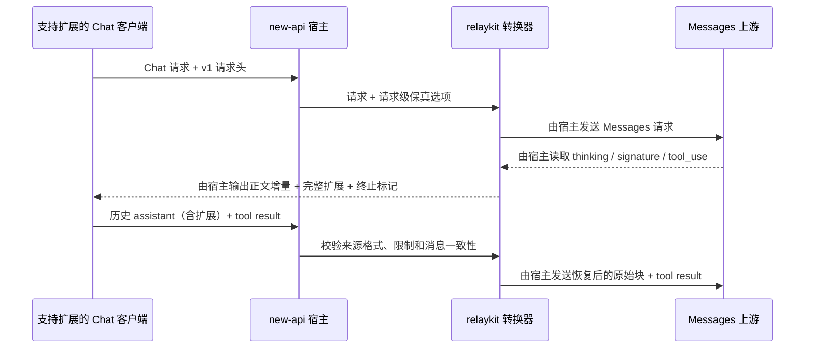

# Messages ↔ Chat 思考内容与签名保真转换方案（v0.1 待评审）

日期：2026-10-03

状态：在已同意的借鉴方向上形成的具体方案，等待书面评审；字段名、限制与行为是本方案的建议决策，不是已经发布的协议。本轮仅编写设计，不修改运行时代码、不导入补丁、不部署。

## 目标与证据基线

修复 Anthropic Messages 与 OpenAI Chat Completions 转换中的思考正文、签名及不透明思考数据丢失，使支持该约定的客户端能够完成开启 thinking 的连续工具调用。优先保证本 fork 的可靠性、可维护性和可回退性；提交上游是次要目标，但提交历史应方便移植。

当前 main：`28b8bfb834e7835f5b5f778fac1b128f6c4265b2`，运行时对应官方 `v1.0.0-rc.41`（`2035a82aeb5414253a728bd937d4b8f97aa99b9b`）。对照基线为材料所述生产前驱 `f98e7b6b44d5a2f1bcd1932d5576fc6e5215bcc4` 和 rc.33 候选 `0ff70000a5b36c1741e7f312c4dc988223fa4abc`；线上实际镜像 digest 尚未确认。

三个基线的隔离转换函数复测均确认：

| 编号 | 路径 | 当前缺口 |
| --- | --- | --- |
| P1 | Messages 流式响应 → Chat | signature_delta 被替换为 reasoning_content 中的换行 |
| P2 | Messages 非流式响应 → Chat | thinking 正文保留，signature 丢失 |
| P3 | Messages 请求 → Chat | 历史 assistant thinking 正文和签名丢失 |
| P4 | Chat 请求 → Messages | 历史 reasoning_content 未恢复为 thinking 块 |

补充探针确认：生产使用的流式状态转换器仍有 P1；多个非流式 thinking 块只留下最后一段 message.reasoning_content；redacted_thinking 数据未保留；ClaudeMediaMessage 的 string + omitempty 无法区分缺省和空签名。DTO 重编码缺口不代表原始 SSE 事件透传也会丢字段。

原始材料：`/Users/liyongsheng/Projects/desirecore/.desirecore/plans/issue-3481-root-cause/deliverables/newapi-thinking-review/`。本轮复测日志：`/private/tmp/newapi-thinking-review-20261003/`（临时诊断文件，不作为长期发布验收存档）。探针 PASS 表示复现旧缺口，不表示协议正确。

## 1. 方案摘要与支持边界

采用“正文映射 + 显式启用的原始块往返扩展”，不引入跨请求服务端状态。

- 普通转换：修复 Messages → Chat 历史正文丢失、非流式多段正文覆盖；保留已有客户端发送的空字符串，不补造正文和签名。
- 保真模式：Chat 客户端通过请求头 `X-New-Api-Reasoning-Transport: v1` 启用；网关将 Messages 原始 assistant 内容块作为有版本的扩展对象返回，客户端原样存储并随工具结果回传，网关验证一致性后恢复。
- 首期保真模式只支持 Chat 入口 → Messages 出口、普通 assistant thinking/text/redacted_thinking/tool_use。工具结果仍由正常消息链传输，不放进 assistant 扩展对象。
- Messages 入口 → 原生 Chat 出口先实现思考正文投影（P3）；Chat 上游没有原始 Anthropic 签名时，不宣称可以反向生成真实签名。
- 同协议路径维持原本的签名信息；首期不扩展 Responses、Gemini、不承诺跨厂商/跨模型签名可用。

这一区分是协议能力边界，不是将 P4 视为可以忽略：P4 在具备原始块的保真路径中完整恢复；只有裸 reasoning_content 的输入无法凭空恢复签名，必须按下文规则明确处理。

## 2. 架构与数据流



图中跨网络发送均由宿主完成；relaykit 仅转换数据，不建立连接。

- **relaykit**：DTO、扩展对象验证、正文投影、原始块恢复、单次流式状态。复用现有 request/response registry、`convmeta.Options` 和流式状态；不新增 `Meta` 必选方法，不破坏独立宿主的接口实现。
- **宿主**：请求头协商、实际路由核验、错误映射、每次重试的选项重建、日志脱敏。协商头仅供本网关消费，不能透传给厂商。
- **客户端**：保存扩展、流式最终对象聚合、下一轮原样回传。DesireCore 适配独立于 new-api PR；尚未授权修改其仓库，本方案将其作为端到端验收依赖。

不创建通用多厂商 IR、签名缓存、会话数据库或自动修复重试机制。所需跨请求数据由客户端携带，多个网关实例可无状态处理。

## 3. 扩展数据结构

建议字段名为 **`newapi_reasoning`**，避免将 `reasoning_opaque` 的单字符串用法重新解释为不兼容对象，也避免与其他厂商的 reasoning_details 混用。它是 new-api 兼容扩展，不是 OpenAI 标准字段。

在非流式 `choices[i].message` 以及客户端下一轮的 assistant message 上采用相同结构：

```json
{
  "role": "assistant",
  "content": "我先查询。",
  "reasoning_content": "需要查询天气。",
  "tool_calls": [
    {"id": "t1", "type": "function", "function": {"name": "lookup", "arguments": "{\"city\":\"杭州\"}"}}
  ],
  "newapi_reasoning": {
    "version": 1,
    "source": "anthropic_messages",
    "content": [
      {"type": "thinking", "thinking": "需要查询天气。", "signature": "synthetic-example-signature"},
      {"type": "text", "text": "我先查询。"},
      {"type": "tool_use", "id": "t1", "name": "lookup", "input": {"city": "杭州"}}
    ]
  }
}
```

该示例签名是合成占位值，不能用于厂商校验。

### 为什么保存完整的受支持内容块序列

签名与 thinking 的配对还不够；text/tool_use 的交错顺序也需要恢复。v1 保存同一 assistant 消息的受支持 `content` 序列，避免设计位置引用、文本切片偏移和工具 ID 映射的第二套恢复语言。代价是重复保存 text 和工具参数，因此必须限制大小，并在回传时校验两份表示一致。

只保存消息内容，不复制 model、system、tools 定义、usage、请求参数或响应内部字段；不把扩展当作任意 JSON 透传容器。

### v1 支持的块与精度

| 块 | 字段 | 规则 |
| --- | --- | --- |
| thinking | type、thinking、signature | thinking 必须存在且为字符串；signature 缺省、空、非空分别保留 |
| redacted_thinking | type、data | data 必须存在且为字符串；不解密、不展示、不改成普通 thinking |
| text | type、text | text 必须存在且为字符串，空串保留 |
| tool_use | type、id、name、input | input 为 JSON 对象，原值保留；ID、名称和参数必须与 Chat tool_calls 对应 |

未知版本、来源、块类型及具有语义的额外块字段在 v1 保真路径中拒绝，不能静默丢弃；例如 citations、hosted tools、cache_control 块扩展需要单独支持后才纳入。普通兼容模式不受该受支持子集限制。对象解码不接受重复关键字段；工具参数比较使用保留数值精度的 JSON 解析，不转为 float64。

“保真”指字符串值、字段是否存在、JSON 值和块顺序保持；不要求 JSON 空白、键顺序或转义拼写保持字节一致。

### 演进规则

version=1 的语义冻结后不得重解释。新增无法由 v1 无损表达的块需新版本并显式协商。source 用于选择解码语义，不作为可信认证或路由权限。不在 v1 接受 #6998 正文标记，也不把 #4591 的 reasoning_opaque 自动升级成完整块结构。

## 4. 正文投影与恢复规则

### Messages → Chat

1. 仅 assistant 的 thinking 正文依序拼接到 reasoning_content，**不额外插入分隔符**；显式空 thinking 对应非 nil 空串。redacted 数据不参与正文。
2. text 依序投影到 Chat content，tool_use 保留 ID、名称、参数及工具数组顺序。保真路径固定 text 为拼接后的字符串；无 text 块时输出 null。
3. 普通模式下，不向原生 Chat 上游添加 newapi_reasoning。不能假定厂商接受未知扩展。
4. 保真响应模式下，除正文投影外保存完整受支持块序列。签名 delta 不再制造 reasoning_content 换行。
5. 无 thinking/redacted 块时不创建扩展；无思考场景维持已有转换和输出。

### Chat → Messages，存在扩展

- 扩展仅允许在 assistant 消息上；先校验版本、白名单、限制和结构，再计算其 Chat 投影。
- 普通 content、reasoning_content 和 tool_calls 必须与投影一致。无可读 thinking 块时 reasoning_content 应缺省；有空 thinking 时必须保留空串。若兼容别名 reasoning 同时出现，必须与 reasoning_content 一致。
- content 无文本时允许 null 或缺省，不等同于显式存在的空 text 块。工具参数按 JSON 值比较，键顺序/空白可不同；工具 ID、名称、数组顺序和字符串值必须相同。
- 不一致即返回明确客户端错误，不选择其中一份悄悄覆盖另一份。
- 验证后按扩展内顺序恢复 content。不得经过原有相邻 assistant 字符串拼接逻辑；保真模式若遇到需要合并的相邻 assistant 消息则拒绝，提示客户端保留原消息边界。
- 只恢复列出的内容字段；工具结果仍来自独立 tool 消息，沿用现有配对验证。

### Chat → Messages，没有扩展

- 未启用 v1：保留现有兼容行为，补充已有转换诊断所能表达的损失类别，不声称已解决签名往返。
- 已启用 v1 且 assistant 带 reasoning_content/reasoning：返回 `reasoning_replay_required`，不按“最新/较早回合”猜测能否合成无签名块。
- 没有正文或扩展的普通历史继续按既有转换处理。网关不能从字段都被删除的历史中判断原来是否有 thinking；不承诺检测这种不可观察的客户端丢失。
- 首期不新增“任意模型允许无签名 thinking”的开关。特定厂商的无签名回放能力如需支持，须另立有文档和实测依据的适配。

### 上下文和信任边界

校验只能证明当前 assistant 的两份表示相符，不能证明上游生成过该签名，也不能验证 system/tools/更早历史是否被修改。客户端应保持这些上下文稳定；最终签名校验仍由厂商执行。网关不因 source 字段而切换渠道，不根据扩展里的客户端声明赋予任何信任。

## 5. 流式传输约定

v1 不在扩展中设计另一套字段增量协议；**正文照常流式，扩展在消息完成时发送一次完整对象**。

1. Claude → Chat 状态机按上游 block index 保存受支持块；thinking/text/signature 分片分别按到达顺序追加，input_json_delta 累积后校验工具对象。初始 content_block_start 的值也必须保留。
2. block_start/delta/stop 的状态转换要合法；缺失 start、重复 stop、未知块、非法工具参数、签名生命周期错误均终止保真转换，不能生成成功对象。
3. 只有所有块已闭合并收到明确的消息终止信息后，才生成完整 newapi_reasoning。它放在最终 `choices[i].delta`，与该 choice 的 finish_reason **同一个 chunk** 发出；usage-only chunk 和最终 `[DONE]` 按现有链路处理。不得先输出正常 finish_reason 再补扩展。
4. 客户端先消费整个 chunk 的 delta，再处理 finish_reason；将对象原样保存为 assistant.newapi_reasoning，不做字符串拼接、文本摘要或 JSON 递归合并。每个 choice 最多接受一个完整对象，重复对象视为协议错误。
5. 工具执行/提交下一轮前需等到完整 assistant 响应完成。中断流没有可用于成功续轮的扩展，客户端不得将其标记为完整工具轮。
6. 内存有上限；流中出错后通过现有 SSE 错误机制发送错误并结束，不伪造正常 finish_reason/[DONE]。HTTP 头已发出时不能再承诺 HTTP 400/502。

普通 Messages 同协议 SSE 内容事件继续走原始事件转发；不因 DTO 的指针改动就重编码这些事件。

## 6. 协商、宿主集成和兼容

- 新请求头只作用于本次请求，映射到 `convmeta.Options` 的新增可选 ReasoningReplay 选项；零值维持兼容模式。
- 开启 v1 时必须是 Chat 入口且实际选择 Messages 出口，成功响应返回同名同值确认头。其他协议、原生 Chat 上游、多跳转换和全体原始 body 透传模式返回 `reasoning_transport_unsupported`。不能在透传模式下忽略本地协议约定。
- request 带 newapi_reasoning 却未启用 v1，返回显式错误，避免被 DTO 忽略或发到普通厂商。
- 协商选项与实际路由检查在每次渠道重试重建；签名请求的同一次重试限于同一渠道，不能自动切到另一厂商/模型。跨请求的渠道亲和仍依赖现有配置，验收需固定渠道与上游模型；v1 不新增跨请求会话路由。
- 本次不增加管理界面、数据库字段或持久化渠道设置。宿主实现依赖明确的入口/出口协议，不用模型名称字符串猜测签名要求。
- 将自定义协商头加入适用的 CORS 请求头/响应暴露规则；使用现有机制，不改变认证与授权策略。
- DesireCore 适配只需协商、保存、聚合、回传和完整轮次检查，不能把本扩展当作 UI 文本或推理摘要。
- 旧客户端不启用头即可继续运行；它们不会获得“签名无损往返”的保证。新客户端不能假设旧网关支持 v1：缺少确认头时应明确不支持，不开启依赖该能力的工具循环。

## 7. 资源限制、错误和日志

建议 v1 起始限制（作为资源边界，不冒充厂商限制）：单条扩展编码后最多 1 MiB；单请求所有扩展合计最多 8 MiB；单 assistant 最多 256 个内容块。流式每个 choice 的累计重建内容也计入同一单消息上限。按 UTF-8 字节累计检查并验证最终 JSON 编码大小；不截断后继续。

宿主现有 `MAX_REQUEST_BODY_MB` 继续限制整个解压后请求体，两者同时生效、取更严格约束。relaykit 提供默认值，宿主可通过 Options 降低限制，不能用零值意外关闭限制。定稿前使用实际长签名及工具参数样本验证是否合理；提高上限需要新的资源验证，不改变 v1 格式。

| 情况 | 请求/非流式 HTTP 行为 | 说明 |
| --- | --- | --- |
| 未协商、错误版本/来源/块结构 | 400 `invalid_reasoning_replay` | 明确字段路径，不带原始内容 |
| 裸 reasoning 在严格恢复路径中缺少原始块 | 400 `reasoning_replay_required` | 不补签名、不关闭 thinking |
| 正文/工具与扩展不一致 | 400 `reasoning_replay_mismatch` | 不自动修复历史 |
| 请求扩展超限 | 413 `reasoning_replay_too_large` | 请求预检应在预扣费和上游调用前完成 |
| 实际路由不支持 | 400 `reasoning_transport_unsupported` | 禁止自动降级 |
| 上游返回无法表达/超限/不完整块序列 | 502 `reasoning_replay_unrepresentable` | 流已开始时改走 SSE 错误 |

无原始数据日志：只记录协议路径、错误类别、块数、字节数及 request ID。错误消息和常规 debug dump 同样不得带本扩展的签名或正文，需审计已有请求/响应日志位置。真实上游失败继续使用既有结算和审计链路，不能因本地转换失败假定没有产生上游费用；计费算法不在本次重写范围。

扩展是原始内容的另一种表示，不是额外生成的文本。请求 token 估算不能把 Chat 正文和快照里的副本重复计数，也不能把本地 envelope 的 JSON 当作新增可计费正文；恢复后的原生字段仍按既有目标协议规则处理。响应 usage 继续使用原有权威来源。需增加带/不带本地封装时计费量不被重复累计的回归用例；如果实现触及计费字段或估算路径，先遵循项目 billing.md 的专项规则。

## 8. 代码落点与实现约束

- `relaykit/dto/`：可选扩展 DTO，Claude signature 的缺省/空区分；仅允许 typed 白名单，复用 kitutil 编解码。
- `relaykit/relayconvert/internal/`：共享的协议域逻辑用于快照投影/验证/恢复，命名表达保真回放概念；不创建单调用的机械 helper。
- `internal/claude_messages/to_oai_chat_req.go`、`to_oai_chat_resp.go`：P1/P2/P3、非流式与流式收集。
- `internal/oai_chat/to_claude_messages_req.go`：P4 一致性校验和原始块恢复，避开消息合并的破坏。
- `convmeta.Options`、response registry 和现有流式状态：请求级启用、限制及终态传递。响应保真错误独立于现有 ToolLossPolicy；后者目前明确不拒绝响应转换，不复用它改变现有行为。
- `service/request_converter.go`、`service/response_converter.go` 及相应 relay handler/adaptor：协调选项、协商头、路由、错误和输出终态。预检复用验证结果，避免多次复制大对象。
- 根模块 JSON 使用 common，relaykit 使用 kitutil；无 root-only 依赖，无数据库或全局会话状态。

## 9. 测试与验收

| 层次 | 必须证明的行为 |
| --- | --- |
| DTO/单函数 | 缺省、空、非空值；多 thinking 聚合；redacted 不进入正文；无思考不回归 |
| 完整转换 | 原始 assistant → Chat → 原始 assistant 保留块顺序、字符串和工具 JSON 值；P1–P4 对应路径均有用例 |
| 流式状态 | 不同分片方式产生同一扩展；初始非空块、分段签名、并行工具；扩展不晚于 finish_reason；中断不输出成功 |
| 错误边界 | 未知版本、未知字段/块、超限、重复键、错序事件、历史被编辑、相邻 assistant、缺少协商及错误路由 |
| 客户端契约 | SDK 原始 JSON → 客户端聚合/持久化 → 下一轮 request，扩展完整；未协商客户端和旧网关的行为明确 |
| 实际联调 | 固定渠道/厂商/模型，连续两次无副作用工具调用再最终回答；对照直连、同协议、保真跨协议；补流式/非流式与 thinking 关闭场景 |

优先扩展现有合适测试文件，不按每层机械新建同一功能的测试文件。测试保护行为，require 负责前置条件、assert 负责值检查；不将私有字段布局当作契约。

必要检查：relaykit 独立 `GOWORK=off go test ./...`、`GOWORK=off go build ./...`；受影响宿主测试与构建；客户端契约用例。没有数据库行为变更时不为此方案引入数据库迁移；实现若扩展到持久化配置或 ORM 路径，则按项目要求补真实三数据库验证。

验收不能把来源探针的“复现丢失 PASS”当作正确性测试。必须改为断言字段完整保留，以及不可表达路径明确失败。暂存于 /private/tmp 的旧探针只作调查依据，正式用例进入代码库。

## 10. commit、PR 与发布安排

| PR | 可独立评审的交付 | 依赖与边界 |
| --- | --- | --- |
| A：思考正文保留 | assistant-only 历史正文、多段非流式聚合、显式空值、工具共存回归 | 不声称保留签名；修复和测试同提交 |
| B：原生签名字段保真 | 缺省/空/非空签名的 DTO 和实际重编码路径修复 | 独立于新扩展；原始 SSE 转发不重写 |
| C：v1 保真往返 | 扩展 DTO/校验、请求恢复、响应收集、宿主协商和端到端契约 | 依赖 A/B；一个功能 PR 完整交付，不部署只输出不恢复的中间状态 |
| 客户端配套 | DesireCore 协商、持久化和工具循环验证 | 单独仓库的 PR；实际修改需用户授权，不能混入 new-api |

C 内部按“数据契约与测试 → 转换与往返测试 → 宿主协商/错误映射与测试”组织可构建提交；全部完成后才启用联调。每个提交都说明行为，不加入无关格式化和重构。若实际实现规模要求拆 C，采用依赖 PR 且功能在完整合入前不可启用。

从明确官方 tag 创建候选基线；main 保持上游镜像。功能分支用 codex/ 前缀，fork 内 PR 目标为单独文档化的集成候选分支而非 main，候选分支必须只包含所选 tag 和本次必要补丁。部署前更新 docs/patches.md，记录来源、提交、测试、数据影响和回退。

只借鉴思路时列出参考；复制实现或测试时保留原作者与提交归属。向官方提 PR 前重新检查上游 HEAD 的等效实现，并移除 fork 配置/研究文档等非必要差异，不为“容易上游合入”牺牲验收范围。

灰度先验证客户端与候选网关，再固定已验证镜像 digest 发布。回退旧版本前必须处理已有携带扩展的会话：旧网关不能透明接管依赖 v1 的历史；保留兼容网关完成这些会话或明确新建会话，不静默删除扩展。此方案无数据库迁移，但整体升级仍须遵守 fork 发布规则，不能推断镜像回退必然安全。

## 11. 本轮决策与评审重点

本方案已提出具体建议：专用 versioned 对象、受限完整内容快照、终态一次发送、请求头显式协商、严格恢复与普通转换分离、无服务端会话缓存。

请优先评审三个取舍：

1. 接受保真路径需要客户端适配，以及 v1 仅覆盖 Chat 入口 → Messages 出口的明确范围。
2. 接受内容快照带来的重复数据，以换取顺序恢复的直接性和可审查性；大小上限在真实样本验收中确认。
3. 接受保真模式在历史冲突、缺少所需原始块或无法表达时明确失败，不自动补造签名、降级或关闭 thinking。

这些是待批准的方案选择；书面方案评审后再编写实施计划。本轮文档检查不构成运行时验证。

## 上游 PR 参考研究（2026-10-03）

### 检索和证据范围

通过 GitHub API/gh search 检索 QuantumNous/new-api 的 open、closed 和 merged PR，关键词包括 thinking signature、reasoning、思考、signature、reasoning_opaque。按相关性筛选后读取 PR 元数据与代码 diff；对 #4591、#6998、#6593 额外读取 reviews、行内评论及会话评论。搜索有结果数量限制，不宣称穷尽全部历史 PR。

下列评价基于所列 head 的静态代码审阅。没有导入、构建或实测这些 PR；PR 作者和评论者的实测声明单独标注，不作为本 fork 验收。open PR 的 merge_commit_sha 可能是 GitHub 生成的测试合并对象，不能据此认定已合并；以 merged 字段和已落地历史为准。

| PR | 查询时状态 | 本次固定的 head | 用途 |
| --- | --- | --- | --- |
| [#4591](https://github.com/QuantumNous/new-api/pull/4591) | open，未合并 | `c41bacf4a51d9dd94746ad270598612a4ace3000` | 正文/签名分离、空值语义的主要参考 |
| [#6998](https://github.com/QuantumNous/new-api/pull/6998) | open，未合并 | `f11dee4a5ba856aed1c7ebe9741ec4bd302c8037` | 正文内编码签名的备选及反例 |
| [#6593](https://github.com/QuantumNous/new-api/pull/6593) | open，未合并 | `ba31b587a39563b066a1b93ee3b81ddb75846b75` | 请求正文映射、消息合并、回归用例参考 |
| [#4497](https://github.com/QuantumNous/new-api/pull/4497) | open，未合并 | `edbd5347fcf41f6393b0839db833cf1df803cff4` | 厂商 Messages 扩展字段的边界参考 |
| [#4520](https://github.com/QuantumNous/new-api/pull/4520) | 已合并 | `821f130c2812bc9d80b4c54b7f749545d250cf5e` | 已有 reasoning 空值保留机制，避免重复实现 |
| [#7153](https://github.com/QuantumNous/new-api/pull/7153) | closed，未合并 | `ea028e9650c57cd286a5bed301f21400a1f3d0a8` | 自动补空正文方案，非保真修复 |
| [#6629](https://github.com/QuantumNous/new-api/pull/6629) | open，未合并 | `b9e1ddaff613be3c83566327d2034fa9393adb78` | 流式生命周期边界参考 |
| [#6652](https://github.com/QuantumNous/new-api/pull/6652) | open，未合并 | `6d85cadc3544a8c111aed9388bacd3867e8a62d1` | 原生 Messages 兼容的邻近工作 |
| [#6392](https://github.com/QuantumNous/new-api/pull/6392) | open，未合并 | `cabc25623638f5e4108dca8ff2231be253e01739` | Responses 签名错误后降级，首期范围外 |

### #4591：方向最接近，但不是现成的完整往返实现

实际 diff 将 ClaudeMediaMessage.Signature 改为 *string，在 Chat message/delta 增加 *string reasoning_opaque；Messages → Chat 请求从 thinking 块读取正文和签名；Chat → Messages 响应写出 thinking，并在流式思考块关闭时写出签名 delta。

可参考：将签名与正文分离；用指针保存缺省/空值差异；把签名事件放在相关块结束之前。

具体限制：

- 本次 diff 没有覆盖 Claude 响应 → Chat 的签名输出，也没有覆盖 Chat 请求 → Claude 的签名恢复，不能把 PR 摘要中的双向描述当作 P1–P4 全部覆盖。
- reasoning_opaque 是单字符串；Messages 请求遍历多个 thinking 块时直接赋值，仍可能覆盖前一块，不能表达完整块顺序和 redacted 数据。
- 部分响应代码通过非空字符串判断签名，流式关闭逻辑则会构造空签名 delta；DTO 支持 nil/空区分不等于所有转换路径保持该区别。
- 代码基于拆出 relaykit 之前的 dto/、service/ 结构，不能直接视为适配 rc.41 的补丁。

作者和一位用户在评论中报告 ClaudeCode + DeepSeek-V4 工具续轮有效。这是特定链路的外部反馈，尚不能证明普通 SDK 能回传扩展字段，也不能证明 Claude 原生签名的完整往返。

### #6998：实现紧凑，但正文编码不满足当前保真目标

实际 diff 仅修改两个转换文件：把每段 signature_delta 编码为 `{"_sig":"..."}` 追加到 reasoning_content；非流式也追加该标记；反向请求通过 LastIndex 查找最后一个标记，恢复一个 thinking 块。

静态可见的风险：多段签名会形成多个标记，解析器只提取最后一个，前面的标记落入正文；多 thinking 块仍缺少边界；正文自然包含同样标记时存在歧义；标记由字符串拼接生成而不是 JSON 编码；该请求恢复分支本身没有按厂商能力限定无签名正文恢复。当前 diff 没有附带测试，也没有修复 P3。

因此保留为备选方案对照，不建议作为默认承载格式或直接合入。

### #6593：正文处理及测试最值得借鉴，但主动放弃部分保真

实际实现覆盖多种请求协议，包括 assistant-only thinking 正文聚合、纯 thinking 消息保留、相邻消息合并时保留正文，以及工具与文本共存的处理。新增多方向及往返测试，可作为用例来源。

它明确丢弃 redacted_thinking，不保留签名；Chat → Claude 只在非最新 assistant 回合构造无签名 thinking，最新回合故意不恢复。因此不能用作最新工具续轮完整修复。其关于较早回合无签名块被接受的假设必须按实际厂商/模型核实，不能变成通用架构规则。

PR 描述称 tool_use 共存文本处理未改变，但当前 diff 已修改该条件；这说明应以固定 head 的代码为准。评论中还有 #6395 作者要求保留原始分析、实现和测试归属；如果复用相应代码/测试，需追溯原提交并保留署名。

### 已落地和邻近方案

- **#4520 已落地**：ReasoningContent/Reasoning 从 string 改为 *string，保留客户端显式空正文。其合并提交 `6f57dcd2f5a7149561fbad39820988e74a944d4a` 已在当前 main 历史中。复用该约定，不能误把“保留客户端发送的空串”与“网关补造空串”混为一谈。
- **#4497**：在厂商 Messages 消息上保存额外 reasoning_content，属于厂商方言兼容；不等同于标准 thinking 块或原始签名保真。适合帮助明确能力边界，不应把所有 Messages 上游视为同一种语义。
- **#7153**：对含 tool_calls 且缺少 reasoning_content 的 assistant 自动补空字符串。PR 已关闭未合并；它不恢复原始正文，不能满足本设计目标。
- **#6629**：处理 thinking-only 流与工具后文本的客户端兼容。diff 存在丢弃工具后文本的逻辑；其协议解释和适用范围需另验，不纳入本次保真修复。可借鉴边界输入，不直接采用降级策略。
- **#6652**：改动范围包含原生 Messages、count_tokens、错误及流式终止等多层逻辑；不是 P1–P4 的聚焦补丁。首期不整包引入。
- **#6392**：针对 Responses encrypted_content 无效后的缓存与重试降级，解决的是另一问题；首期不引入其缓存及删除历史数据的策略。

### 对本草案的修正结论

1. 优先借鉴 #4591 的正文/签名分离思路、#6593 的正文映射和测试边界、#4520 已有的空值语义，而不是选一个 PR 整体合入。
2. 尚未在本次重点审阅的 PR 中找到同时覆盖多块顺序、分段签名、redacted 数据、客户端回传和 P1–P4 的完整实现。
3. 不应因为 #4591 使用 reasoning_opaque 就直接标准化同名单字符串字段；先确定有版本、块边界、来源和顺序的结构，再决定字段命名和兼容映射。
4. 准确区分“用户原样回传的空字段”“上游合法返回的空签名”和“为了通过校验而补造空字段”。这三种情况需要不同的验收用例。
5. 正文方案第 3–7 节已提出客户端聚合/回传和失败策略的具体建议，仍需评审。代码评审与这些 PR 的外部成功反馈均不能替代本 fork 的实际客户端验证。
